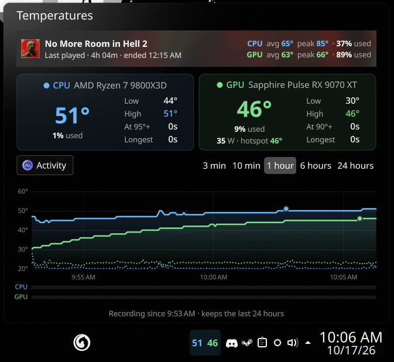
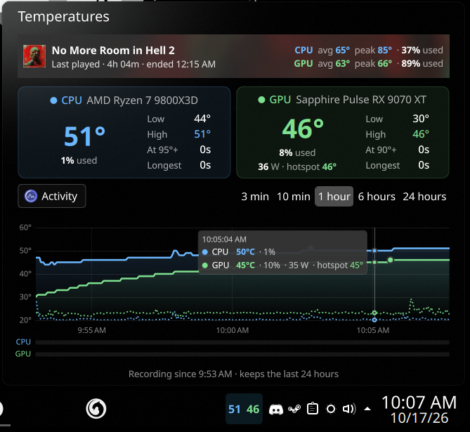
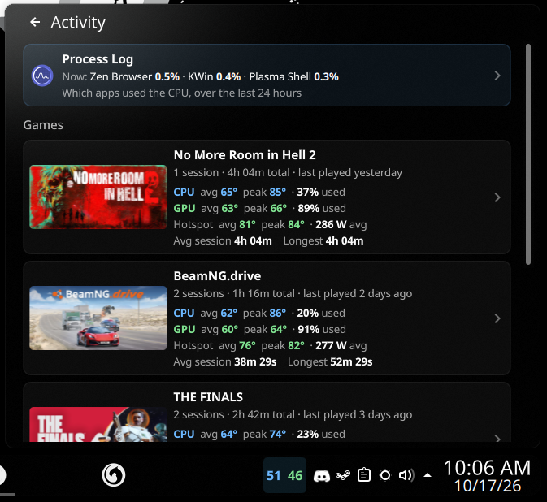
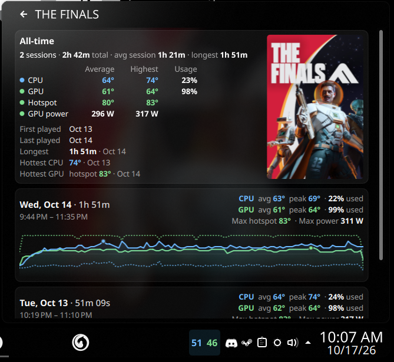
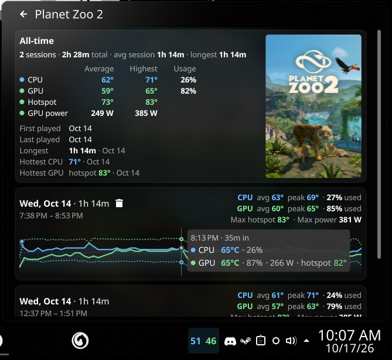

# Temps

A KDE Plasma 6 panel widget that shows your CPU and GPU temperatures, keeps a graph of the last 24 hours, and tracks how hot your hardware runs in each Steam game you play.

> **Personal project.** I built this for my own PC and use it myself. It isn't packaged or supported for anyone else. Parts of it, like the fan sensors, are set up for my hardware. You're welcome to look around or try it, but expect to adjust things, and I may not answer issues or pull requests.



## Features

### Live temperatures in the panel and popup

The panel shows two colored numbers, CPU and GPU (or the game's icon while you're playing). Click them to open the popup, which shows:

- A card for each device with the current temperature, current usage, and the low, high, time spent at the hot threshold and longest stretch there. The GPU card also shows power draw and hotspot (junction) temperature.
- A row with pump and fan speeds, if your motherboard's sensor chip is readable.
- A strip at the top with the game you're playing, or the last one you played, with average and peak temperatures and usage.

### A 24-hour graph

Pick a range: 3 minutes, 10 minutes, 1 hour, 6 hours or 24 hours. Solid lines are temperatures, dotted lines are usage. Hover anywhere on the graph to see the exact readings at that moment. Game sessions show up as labeled bands. History survives panel restarts and reboots.



### Activity: games and the process log

The **Activity** button opens a list of every Steam game you've played, with total play time, session count, and the average and peak temperatures, usage, hotspot and power for each one. Games are detected automatically when Steam launches them. No setup needed.

The **Process Log** at the top shows which apps used the CPU, now or at any point in the last 24 hours. Hover its graph to see what was running at that moment.



### Per-game history

Click a game to see its all-time stats and records (first and last played, longest session, hottest CPU and GPU) next to its Steam poster. Click a record to jump to that session. Below are all of its sessions, each with its own graph.



Hover a session's graph for the readings at any minute of it. Hover a session card to show a delete button.



### Settings

Right-click the widget and choose **Configure Temps…** to change the warning and hot thresholds, line colors, how often temperatures are read, the shortest game session worth saving, and whether to show fan speeds. You can also open the data folder or clear the saved games and history.

## Requirements

- KDE Plasma 6 (with `ksystemstats`, which comes with Plasma)
- Python 3, for the process log
- systemd with cgroup v2, for the process log (the default on current distros)
- Steam (optional), for game tracking
- For pump and fan speeds: a readable motherboard sensor chip. See [Fan speeds](#fan-speeds).

Temps reads the first GPU (`gpu0`). It was built and tested with an AMD Ryzen 7 9800X3D and an AMD Radeon RX 9070 XT on CachyOS.

## Install

Clone the repo and install it with `kpackagetool6`:

```bash
git clone https://github.com/matthewsmason/temps-widget.git
cd temps-widget
kpackagetool6 --type Plasma/Applet --install .
```

Then right-click your panel, choose **Add or Manage Widgets…**, search for **Temps**, and drag it onto the panel.

### Update

```bash
cd temps-widget
git pull
kpackagetool6 --type Plasma/Applet --upgrade .
systemctl --user restart plasma-plasmashell
```

### Uninstall

Remove the widget from your panel, then run:

```bash
kpackagetool6 --type Plasma/Applet --remove blog.matthewmason.temps
```

Saved games and history are kept in `~/.local/share/temperature-monitor/`. Delete that folder to remove them too.

## Fan speeds

The fan row reads an `nct6799` chip (common on recent ASUS boards), and is wired to one specific motherboard: `fan7` is the AIO pump, `fan1` and `fan2` are averaged as the radiator fans, and `fan6` is the chipset fan. If your board uses a different chip or fan headers, change `fanChip` and the fan sensor names in `contents/ui/main.qml`. The row hides itself when the sensors can't be read.

On many boards the chip needs the `nct6775` kernel driver:

```bash
sudo modprobe nct6775
echo nct6775 | sudo tee /etc/modules-load.d/nct6775.conf   # load it at every boot
systemctl --user restart plasma-ksystemstats
```

## Where data is stored

| File | What's in it |
| --- | --- |
| `~/.local/share/temperature-monitor/games.json` | Every game and session, kept forever |
| `~/.local/share/temperature-monitor/history.json` | The last 24 hours of the graph |
| `~/.local/share/temperature-monitor/procs.json` | The last 24 hours of the process log |
